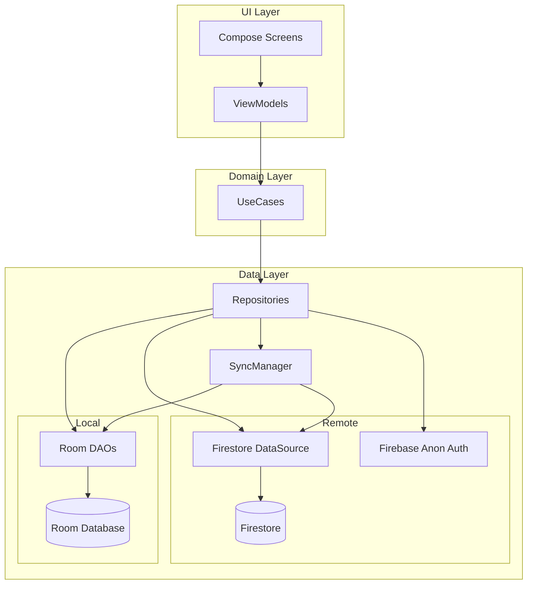
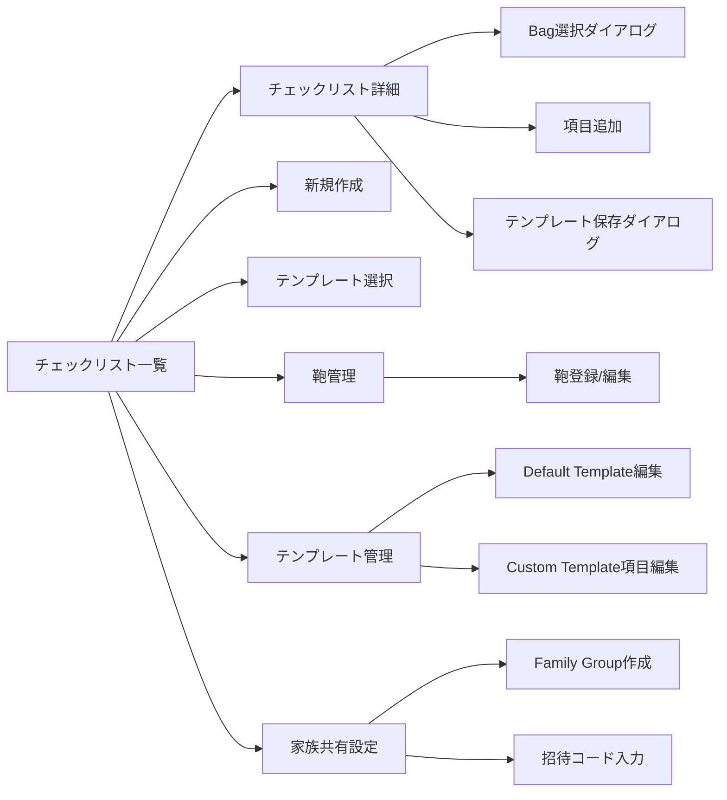
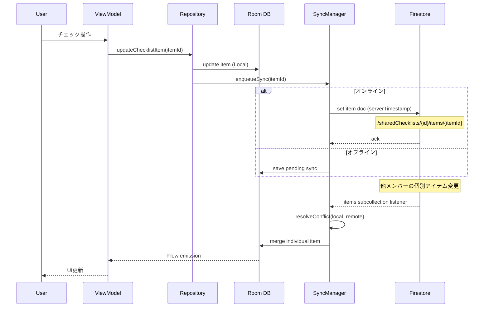

# 設計書: 持ち物チェックリスト (packing-checklist)

## Overview

本設計書は、Androidアプリにおける「持ち物チェックリスト」機能の技術設計を定義する。ユーザーが旅行や外出時に必要な持ち物をリスト化し、チェック操作・鞄割り当て・テンプレート管理・家族間共有を行うための機能である。

技術スタック:
- **UI**: Kotlin + Jetpack Compose (Material 3)
- **ローカルDB**: Room Database (SQLite)
- **リモートDB**: Firebase Firestore (リアルタイム同期)
- **認証**: Firebase Anonymous Authentication（内部的にFirestoreセキュリティルール適用のため使用。ユーザーにログインUIは表示しない）
- **アーキテクチャ**: MVVM + Repository パターン + Clean Architecture
- **DI**: Hilt
- **非同期処理**: Kotlin Coroutines + Flow

### 設計判断の根拠

1. **Room Database**: ローカルデータの永続化にはRoom Databaseを採用する。型安全なDAO、Flowによるリアクティブなデータ取得、マイグレーション機能を備え、Jetpack Composeとの親和性が高い。
2. **Firebase Firestore**: 家族共有・リアルタイム同期にはFirebase Firestoreを採用する。リアルタイムリスナー、オフラインキャッシュ、コンフリクト解決機能を標準で備えており、要件11のリアルタイム同期要件に適合する。
3. **Firebase Anonymous Authentication**: ユーザーにログインUIは表示しないが、内部的にFirebase Anonymous Authenticationを使用してFirestoreのセキュリティルールを適用する。招待コードを十分に複雑（UUID v4ベース等）にすることでセキュリティを担保する。
4. **MVVM + Repository**: UIロジックとデータアクセスを分離し、テスタビリティと保守性を確保する。Repositoryパターンにより、ローカルDBとリモートDBの切り替え・同期ロジックをUI層から隠蔽する。

## Architecture

### 全体アーキテクチャ



### 画面遷移図



### データフロー（同期）



## Components and Interfaces

### UI Layer

| コンポーネント | 責務 |
|---|---|
| `ChecklistListScreen` | チェックリスト一覧表示、スワイプ削除、新規作成ナビゲーション |
| `ChecklistDetailScreen` | チェックリスト詳細、項目チェック/追加/編集/削除、Bag別グループ表示、テンプレートとして保存操作 |
| `BagSelectionDialog` | チェック時のBag選択ダイアログ（優先順位付き表示） |
| `SaveAsTemplateDialog` | チェックリスト詳細画面から呼び出されるCustom Template保存ダイアログ。Checklist_Itemの選択一覧とラベル入力を提供し、選択した項目をCustom_Templateとして保存する |
| `CreateChecklistScreen` | 新規チェックリスト作成（タイトル入力） |
| `TemplateSelectionScreen` | Custom Template選択による新規作成 |
| `TemplateManagementScreen` | Default/Custom Template管理（一覧表示、名前変更、削除） |
| `CustomTemplateEditScreen` | Custom Template項目編集画面。Default Template編集と同じリスト形式で項目の追加・削除が可能 |
| `BagManagementScreen` | Bag_Registry管理（登録/名前変更/削除） |
| `FamilyGroupScreen` | Family Group作成/参加。招待コードのワンタップコピー機能を提供 |

### ViewModel Layer

| ViewModel | 責務 |
|---|---|
| `ChecklistListViewModel` | 一覧取得（作成日降順）、削除処理 |
| `ChecklistDetailViewModel` | 詳細表示、チェック操作、項目CRUD、Bag別グループ化、進捗計算、テンプレート保存（SaveAsCustomTemplateUseCaseの呼び出し） |
| `CreateChecklistViewModel` | バリデーション、Default Template適用、作成処理 |
| `TemplateViewModel` | Default/Custom Template CRUD、テンプレートからの作成（重複除去・統合） |
| `BagViewModel` | Bag CRUD、削除時の関連Checklist_Item更新 |
| `FamilyGroupViewModel` | グループ作成/参加/退出、招待コード生成（UUID v4ベース） |

### Domain Layer (UseCases)

| UseCase | 責務 |
|---|---|
| `CreateChecklistUseCase` | Default Template適用付きチェックリスト作成 |
| `CreateChecklistFromTemplatesUseCase` | 複数Template統合・重複除去・チェックリスト作成 |
| `ToggleCheckItemUseCase` | チェック状態切替 + Bag割り当て/解除 |
| `GetBagSuggestionsUseCase` | Bag選択時の優先順位計算（直前割り当てBag → 割り当て数順 → 残り） |
| `SaveAsCustomTemplateUseCase` | 既存Checklistから選択項目をCustom Templateとして保存 |
| `MergeTemplatesUseCase` | Default + 複数Custom Templateの統合・重複除去 |
| `DeleteBagUseCase` | Bag削除 + 関連Checklist_ItemのBag割り当て解除 |
| `SyncChecklistUseCase` | 共有Checklistの同期処理 |
| `ManageFamilyGroupUseCase` | Family Group作成/参加/退出 |

### Data Layer (Repositories)

| Repository | 責務 |
|---|---|
| `ChecklistRepository` | Checklist CRUD、ローカル/リモート同期 |
| `ChecklistItemRepository` | Checklist_Item CRUD、チェック状態管理 |
| `TemplateRepository` | Default/Custom Template CRUD |
| `BagRepository` | Bag CRUD、Bag_Registry管理 |
| `FamilyGroupRepository` | Family Group管理 |
| `SyncRepository` | 同期キュー管理、コンフリクト解決 |

### 主要インターフェース

```kotlin
// Repository interfaces
interface ChecklistRepository {
    fun getAllChecklists(): Flow<List<Checklist>>
    suspend fun getChecklistById(id: String): Checklist?
    suspend fun createChecklist(title: String): Checklist
    suspend fun deleteChecklist(id: String)
    suspend fun updateChecklistTitle(id: String, title: String)
    suspend fun setSharingEnabled(id: String, enabled: Boolean)
}

interface ChecklistItemRepository {
    fun getItemsByChecklistId(checklistId: String): Flow<List<ChecklistItem>>
    suspend fun addItem(checklistId: String, name: String): ChecklistItem
    suspend fun deleteItem(id: String)
    suspend fun updateItemName(id: String, name: String)
    suspend fun toggleCheck(id: String, bagId: String?): ChecklistItem
    suspend fun uncheckItem(id: String): ChecklistItem
}

interface TemplateRepository {
    fun getDefaultTemplate(): Flow<List<TemplateItem>>
    fun getCustomTemplates(): Flow<List<CustomTemplate>>
    suspend fun updateDefaultTemplate(items: List<TemplateItem>)
    suspend fun saveAsCustomTemplate(label: String, items: List<String>): CustomTemplate
    suspend fun deleteCustomTemplate(id: String)
    suspend fun updateCustomTemplate(id: String, label: String, items: List<String>)
}

interface BagRepository {
    fun getAllBags(): Flow<List<Bag>>
    suspend fun createBag(name: String): Bag
    suspend fun updateBagName(id: String, name: String)
    suspend fun deleteBag(id: String)
}

interface FamilyGroupRepository {
    fun getCurrentGroup(): Flow<FamilyGroup?>
    suspend fun createGroup(): String // returns secure invite code (UUID v4-based)
    suspend fun joinGroup(inviteCode: String) // membersコレクションに自分のドキュメントを追加
    suspend fun leaveGroup() // membersコレクションから自分のドキュメントを削除
}
```

## Data Models

### Room Database Entities

```kotlin
@Entity(tableName = "checklists")
data class ChecklistEntity(
    @PrimaryKey val id: String,
    val title: String,
    val createdAt: Long,
    val updatedAt: Long,
    val isSharingEnabled: Boolean = false,
    val familyGroupId: String? = null,
    val ownerUserId: String? = null
)

@Entity(
    tableName = "checklist_items",
    foreignKeys = [
        ForeignKey(
            entity = ChecklistEntity::class,
            parentColumns = ["id"],
            childColumns = ["checklistId"],
            onDelete = ForeignKey.CASCADE
        )
    ],
    indices = [Index("checklistId")]
)
data class ChecklistItemEntity(
    @PrimaryKey val id: String,
    val checklistId: String,
    val name: String,
    val isChecked: Boolean = false,
    val bagId: String? = null,
    val lastModifiedAt: Long = 0L, // serverTimestampにより常に設定されるためnon-nullable
    val sortOrder: Int = 0
)

@Entity(tableName = "bags")
data class BagEntity(
    @PrimaryKey val id: String,
    val name: String,
    val ownerUserId: String? = null,
    val createdAt: Long
)

@Entity(tableName = "default_template_items")
data class DefaultTemplateItemEntity(
    @PrimaryKey val id: String,
    val name: String,
    val sortOrder: Int
)

@Entity(tableName = "custom_templates")
data class CustomTemplateEntity(
    @PrimaryKey val id: String,
    val label: String,
    val createdAt: Long,
    val updatedAt: Long,
    val ownerUserId: String? = null
)

@Entity(
    tableName = "custom_template_items",
    foreignKeys = [
        ForeignKey(
            entity = CustomTemplateEntity::class,
            parentColumns = ["id"],
            childColumns = ["templateId"],
            onDelete = ForeignKey.CASCADE
        )
    ],
    indices = [Index("templateId")]
)
data class CustomTemplateItemEntity(
    @PrimaryKey val id: String,
    val templateId: String,
    val name: String,
    val sortOrder: Int
)

@Entity(tableName = "family_groups")
data class FamilyGroupEntity(
    @PrimaryKey val id: String,
    val inviteCode: String,
    val createdAt: Long
)

@Entity(tableName = "pending_syncs")
data class PendingSyncEntity(
    @PrimaryKey val id: String,
    val entityType: String, // "checklist", "checklist_item", "bag", "custom_template"
    val entityId: String,
    val operation: String, // "create", "update", "delete"
    val payload: String, // JSON serialized data
    val timestamp: Long,
    val isSynced: Boolean = false
)
```

### Firestore Document Structure

```
/familyGroups/{groupId}
  - inviteCode: String
  - createdAt: Timestamp

/familyGroups/{groupId}/members/{userId}
  - joinedAt: Timestamp

/familyGroups/{groupId}/sharedChecklists/{checklistId}
  - title: String
  - createdAt: Timestamp
  - updatedAt: Timestamp
  - ownerUserId: String

/familyGroups/{groupId}/sharedChecklists/{checklistId}/items/{itemId}
  - name: String
  - isChecked: Boolean
  - bagId: String?
  - lastModifiedAt: Timestamp (serverTimestamp)

/familyGroups/{groupId}/sharedBags/{bagId}
  - name: String
  - ownerUserId: String
  - createdAt: Timestamp

/familyGroups/{groupId}/sharedTemplates/{templateId}
  - label: String
  - ownerUserId: String
  - createdAt: Timestamp
  - updatedAt: Timestamp
  - items: []{name: String, sortOrder: Int}
```

> **設計判断**: sharedChecklistsのitemsを配列埋め込みからサブコレクションに変更した。これにより、1項目の変更でドキュメント全体を書き込む必要がなくなり（書き込みデータ量の大幅削減）、個別アイテムへのリアルタイムリスナーが可能になり、同時編集時のデータ消失リスクが解消される。また、ドキュメントサイズ上限1MBの制約も回避できる。

### Firestoreセキュリティルール

```javascript
rules_version = '2';
service cloud.firestore {
  match /databases/{database}/documents {

    // familyGroupsドキュメント: 認証済みユーザーのみ読み取り・作成可
    match /familyGroups/{groupId} {
      allow read: if request.auth != null;
      allow create: if request.auth != null;

      // メンバー判定関数
      function isMember() {
        return exists(/databases/$(database)/documents/familyGroups/$(groupId)/members/$(request.auth.uid));
      }

      // membersサブコレクション: グループメンバーのみ読み取り可、自分自身のドキュメントのみ作成/削除可
      match /members/{userId} {
        allow read: if isMember();
        allow create: if request.auth != null && request.auth.uid == userId;
        allow delete: if request.auth != null && request.auth.uid == userId;
      }

      // sharedChecklists: グループメンバーのみ読み書き可
      match /sharedChecklists/{checklistId} {
        allow read, write: if isMember();

        // items サブコレクション: グループメンバーのみ読み書き可
        match /items/{itemId} {
          allow read, write: if isMember();
        }
      }

      // sharedBags: グループメンバーのみ読み書き可
      match /sharedBags/{bagId} {
        allow read, write: if isMember();
      }

      // sharedTemplates: グループメンバーのみ読み書き可
      match /sharedTemplates/{templateId} {
        allow read, write: if isMember();
      }
    }
  }
}
```

> **メンバー判定**: `/familyGroups/{groupId}/members/{request.auth.uid}` ドキュメントの存在確認により、グループメンバーシップを判定する。joinGroup()時にmembersコレクションにドキュメントを追加し、leaveGroup()時に削除する。

### Domain Models

```kotlin
data class Checklist(
    val id: String,
    val title: String,
    val createdAt: Long,
    val isSharingEnabled: Boolean,
    val items: List<ChecklistItem> = emptyList(),
    val checkedCount: Int = 0,
    val totalCount: Int = 0
)

data class ChecklistItem(
    val id: String,
    val checklistId: String,
    val name: String,
    val isChecked: Boolean,
    val bag: Bag? = null,
    val lastModifiedAt: Long = 0L // serverTimestampにより常に設定されるためnon-nullable
)

data class Bag(
    val id: String,
    val name: String
)

data class CustomTemplate(
    val id: String,
    val label: String,
    val items: List<String>
)

data class FamilyGroup(
    val id: String,
    val inviteCode: String
)

data class BagSuggestion(
    val bag: Bag,
    val priority: Int // 0: 直前割り当て, 1: 割り当て数順, 2: その他
)
```

### コンフリクト解決戦略

要件11.5に基づき、同一Checklist_Itemへの同時変更は最新タイムスタンプを優先する（Last-Write-Wins）。Firestoreへの書き込み時には `FieldValue.serverTimestamp()` を使用し、クライアント間のクロック差異による不整合を防止する。

同一タイムスタンプの場合は、ドキュメントID（itemId）の辞書順で決定する（タイブレークルール）。

```kotlin
fun resolveConflict(local: ChecklistItemEntity, remote: ChecklistItemEntity): ChecklistItemEntity {
    val localTs = local.lastModifiedAt
    val remoteTs = remote.lastModifiedAt
    return when {
        remoteTs > localTs -> remote
        remoteTs < localTs -> local
        // 同一タイムスタンプ時: ドキュメントID辞書順で決定
        else -> if (remote.id >= local.id) remote else local
    }
}
```

> **設計判断**: `FieldValue.serverTimestamp()` を使用することで、クライアント端末の時刻設定に依存しない一貫したタイムスタンプが保証される。lastModifiedAtはserverTimestampにより常に設定されるため、non-nullableとする。

## Correctness Properties

*プロパティとは、システムの全ての有効な実行において真であるべき特性や振る舞いのことである。本質的には、システムが何をすべきかについての形式的な記述であり、人間が読める仕様と機械的に検証可能な正しさの保証を橋渡しする役割を果たす。*

### Property 1: チェックリスト保存のラウンドトリップ

*For any* 有効なタイトル文字列（非空・非ホワイトスペースのみ）に対して、そのタイトルでChecklistを作成しLocal_Databaseに保存した後、IDで取得すると同じタイトルのChecklistが返される。

**Validates: Requirements 1.2, 7.1, 7.2**

### Property 2: 空文字列バリデーション

*For any* ホワイトスペースのみで構成された文字列（空文字列を含む）に対して、Checklistのタイトル、Checklist_Itemの名前、Bagの名前としての保存は拒否され、既存のデータは変更されない。

**Validates: Requirements 1.3, 2.4, 9.3**

### Property 3: Default_Template自動適用

*For any* Default_Templateの内容に対して、新しいChecklistを作成した時、作成されたChecklistのChecklist_Item群はDefault_Templateの全項目と一致し、全て未チェック状態かつBag未割り当てである。

**Validates: Requirements 1.4**

### Property 4: 持ち物追加による項目数増加

*For any* Checklistと有効な持ち物名（非空）に対して、持ち物を追加するとChecklistの項目数が1つ増加し、追加された項目は未チェック状態かつBag未割り当てである。

**Validates: Requirements 2.2, 2.3**

### Property 5: Bag選択時の優先順位ソート

*For any* Checklist（複数のChecklist_Itemが異なるBagに割り当て済み）とBag_Registryに対して、Bag選択候補の表示順序は「直前に割り当てたBag → 現在のChecklist内で割り当て数の多い順 → 残りのBag」の順序である。

**Validates: Requirements 3.1, 3.2**

### Property 6: チェック操作の状態遷移

*For any* 未チェック状態のChecklist_Itemに対して、Bagを選択してチェックするとisChecked=trueかつ選択したBagが割り当てられ、BagをスキップしてチェックするとisChecked=trueかつBag=nullとなる。

**Validates: Requirements 3.3, 3.4**

### Property 7: チェック解除によるBag割り当て解除

*For any* チェック済み（Bag割り当て済み）のChecklist_Itemに対して、チェックを解除するとisChecked=falseかつBag=nullとなる。

**Validates: Requirements 3.6**

### Property 8: チェック進捗の正確性

*For any* Checklist（N個の項目のうちM個がチェック済み）に対して、進捗表示は「M/N」の形式であり、M <= Nかつ0 <= Mである。

**Validates: Requirements 3.8**

### Property 9: Checklist_Item削除

*For any* ChecklistとそのChecklist_Itemに対して、項目を削除するとChecklistの項目数が1つ減少し、削除された項目はChecklistに含まれない。

**Validates: Requirements 4.2**

### Property 10: Checklist削除のカスケード

*For any* Checklistとその関連Checklist_Item群に対して、Checklistを削除すると、そのChecklistと全ての関連Checklist_ItemがLocal_Databaseから削除される。

**Validates: Requirements 4.4**

### Property 11: テンプレート統合の重複除去

*For any* Default_Templateと1つ以上のCustom_Templateに対して、統合して新しいChecklistを作成した時、結果のChecklist_Item群は全テンプレートの項目の和集合（重複除去済み）と一致し、全て未チェック状態である。

**Validates: Requirements 5.6, 5.7**

### Property 12: Custom_Template保存のラウンドトリップ

*For any* Checklistと選択された項目のサブセットとラベル文字列に対して、Custom_Templateとして保存した後に取得すると、同じラベルと選択された項目のみが含まれる。

**Validates: Requirements 5.3, 5.4**

### Property 13: チェックリスト一覧の作成日降順ソート

*For any* 複数のChecklist群に対して、一覧取得の結果は作成日の降順（新しい順）でソートされている。

**Validates: Requirements 6.4**

### Property 14: 一覧表示データの完全性

*For any* Checklistに対して、一覧表示データにはタイトル、チェック進捗（M/N形式）、作成日が含まれる。

**Validates: Requirements 6.2**

### Property 15: Bag別グループ化

*For any* Checklist_Item群に対して、Bag別グループ化の結果は、各Bagに割り当てられた項目がそのBagのグループに含まれ、Bag未割り当ての項目は「未分類」グループに含まれ、全項目がいずれかのグループに属する。

**Validates: Requirements 8.2, 8.3**

### Property 16: Bag登録のラウンドトリップ

*For any* 有効な鞄名（非空）に対して、Bagを登録した後にBag_Registryから取得すると同じ名前のBagが含まれる。

**Validates: Requirements 9.2**

### Property 17: Bag削除時の関連アイテム更新

*For any* BagとそのBagが割り当てられた複数のChecklist_Itemに対して、Bagを削除すると、全ての関連Checklist_ItemのBag割り当てがnullになる。

**Validates: Requirements 9.6**

### Property 18: 新規Checklistの非共有初期設定

*For any* 新規作成されたChecklistに対して、Sharing_Settingはデフォルトで非共有（false）である。

**Validates: Requirements 10.9**

### Property 19: 共有設定による公開制御

*For any* Family_Groupに属するChecklistに対して、Sharing_Settingが有効な場合のみRemote_Databaseに同期され、非共有の場合はLocal_Databaseのみに保存される。

**Validates: Requirements 10.3, 10.11**

### Property 20: Family_Group参加・退出

*For any* UserとFamily_Groupに対して、招待コードで参加するとFamily_Groupに所属した状態となり、退出するとFamily_Groupから離脱した状態となる。

**Validates: Requirements 10.2, 10.5**

### Property 21: コンフリクト解決（Last-Write-Wins with serverTimestamp）

*For any* 同一Checklist_Itemに対する2つの変更（serverTimestampによるタイムスタンプ付き）に対して、コンフリクト解決の結果は最新のタイムスタンプを持つ変更が適用される。タイムスタンプが同一の場合は、ドキュメントIDの辞書順で大きい方が適用される。

**Validates: Requirements 11.5**

### Property 22: オフライン変更の同期

*For any* オフライン中に行われた変更群に対して、ネットワーク復旧後に全ての未同期変更がRemote_Databaseに送信され、ローカルとリモートの状態が一致する。

**Validates: Requirements 11.3, 11.4**

## Error Handling

### バリデーションエラー

| エラー条件 | 対応 | 関連要件 |
|---|---|---|
| 空タイトルでのChecklist作成 | エラーメッセージ「タイトルを入力してください」表示、保存拒否 | 1.3 |
| 空名前でのChecklist_Item追加 | 項目追加せず入力欄クリア | 2.4 |
| 空名前でのBag登録 | エラーメッセージ「鞄の名前を入力してください」表示、保存拒否 | 9.3 |

### ネットワークエラー

| エラー条件 | 対応 | 関連要件 |
|---|---|---|
| ネットワーク切断中の同期操作 | ローカルDBに変更を保存、PendingSyncEntityに記録 | 11.3 |
| ネットワーク復旧 | PendingSyncEntityの未同期変更をFirestoreに送信 | 11.4 |
| Firestore書き込み失敗 | リトライキューに追加、指数バックオフで再試行 | 11.1 |

### データ整合性エラー

| エラー条件 | 対応 | 関連要件 |
|---|---|---|
| 同時変更コンフリクト | Last-Write-Wins（serverTimestamp優先、同一タイムスタンプ時はドキュメントID辞書順） | 11.5 |
| 存在しないBagへの参照 | Bag割り当てをnullにリセット | 9.6 |
| 存在しないChecklistへの操作 | 操作を無視、ログ記録 | - |

### エラーハンドリング方針

```kotlin
// Repositoryレベルでのエラーハンドリング
sealed class Result<out T> {
    data class Success<T>(val data: T) : Result<T>()
    data class Error(val exception: Throwable) : Result<Nothing>()
}

// ViewModelレベルでのUI状態管理
data class UiState<T>(
    val data: T? = null,
    val isLoading: Boolean = false,
    val error: String? = null
)
```

## Testing Strategy

### テスト方針

本機能では、ユニットテストとプロパティベーステストの2つのアプローチを併用する。

- **ユニットテスト**: 具体的な例、エッジケース、エラー条件の検証に使用
- **プロパティベーステスト**: 全入力に対して普遍的に成立すべきプロパティの検証に使用

### プロパティベーステスト設定

- **ライブラリ**: [Kotest](https://kotest.io/) の Property Testing モジュール (`kotest-property`)
- **最小反復回数**: 各プロパティテストにつき100回以上
- **タグ形式**: `// Feature: packing-checklist, Property {number}: {property_text}`

### テスト対象と方針

| テスト種別 | 対象 | ツール |
|---|---|---|
| プロパティテスト | Correctness Properties 1〜22 | Kotest Property Testing |
| ユニットテスト | エッジケース（Bag未登録時のチェック操作等）、エラー条件、UI状態遷移 | JUnit 5 + Kotest Assertions |
| 統合テスト | Room DAO操作、Repository層のローカル/リモート連携 | AndroidX Test + Room in-memory DB |
| UIテスト | 画面遷移、ユーザー操作フロー | Compose UI Test |

### プロパティテスト実装例

```kotlin
class ChecklistPropertyTest : FunSpec({
    // Feature: packing-checklist, Property 2: 空文字列バリデーション
    test("空文字列・ホワイトスペースのみの文字列はバリデーションで拒否される") {
        checkAll(100, Arb.string().filter { it.isBlank() }) { input ->
            val result = validator.validateTitle(input)
            result.shouldBeInstanceOf<ValidationResult.Invalid>()
        }
    }

    // Feature: packing-checklist, Property 11: テンプレート統合の重複除去
    test("テンプレート統合は重複を除去し全項目を含む") {
        checkAll(
            100,
            Arb.list(Arb.string(1..50), 1..20),  // default items
            Arb.list(Arb.list(Arb.string(1..50), 1..20), 1..5)  // custom templates
        ) { defaultItems, customTemplates ->
            val allItems = (defaultItems + customTemplates.flatten()).toSet()
            val result = mergeTemplatesUseCase(defaultItems, customTemplates)
            result.map { it.name }.toSet() shouldBe allItems
            result.all { !it.isChecked } shouldBe true
        }
    }

    // Feature: packing-checklist, Property 21: コンフリクト解決（Last-Write-Wins with serverTimestamp）
    test("コンフリクト解決は最新タイムスタンプを優先し、同一タイムスタンプ時はドキュメントID辞書順で決定する") {
        checkAll(
            100,
            Arb.long(1..Long.MAX_VALUE),
            Arb.long(1..Long.MAX_VALUE),
            Arb.string(10..20, Codepoint.alphanumeric()),
            Arb.string(10..20, Codepoint.alphanumeric())
        ) { timestamp1, timestamp2, id1, id2 ->
            val item1 = createItem(id = id1, lastModifiedAt = timestamp1)
            val item2 = createItem(id = id2, lastModifiedAt = timestamp2)
            val result = resolveConflict(item1, item2)
            when {
                timestamp1 != timestamp2 -> result.lastModifiedAt shouldBe maxOf(timestamp1, timestamp2)
                else -> result.id shouldBe maxOf(id1, id2) // タイブレーク: ドキュメントID辞書順
            }
        }
    }
})
```

### ユニットテスト対象（エッジケース・具体例）

- Bag_Registryが空の場合のチェック操作（要件3.5）: Bag選択画面をスキップして直接チェック済みにする
- Default_Templateの初期搭載内容の検証（要件5.1）: 具体的な初期項目セットの確認
- Custom_Template一覧表示（要件5.5）: テンプレート選択画面の表示確認
- Bag_Registry一覧表示（要件9.4）: 登録済みBagの一覧表示確認
- 招待コードの複雑性検証（要件10.6）: UUID v4ベースの招待コードが十分な長さ・複雑性を持つことの確認

